<p align="center">
  <picture>
    <source media="(prefers-color-scheme: dark)" srcset="assets/vibeslayer-hero-dark.svg" />
    <source media="(prefers-color-scheme: light)" srcset="assets/vibeslayer-hero-light.svg" />
    
  </picture>
</p>

<h1 align="center">Vibe-Slayer</h1>

<p align="center">
  Zero-Dependency Rust + C99 Asset &amp; Runtime Protection Platform
</p>

<p align="center">
  <a href="https://github.com/HUSMUS9999/vibe-slayer/releases/tag/v1.0.0-beta.3"></a>
  <a href="#architecture--packages"></a>
  <a href="#architecture--packages"></a>
  <a href="#quickstart"></a>
  <a href="LICENSE"></a>
</p>

**Vibe-Slayer** compiles to a single standalone Rust + C99 binary with zero external crates or runtime dependencies — replacing fragile static obfuscation with real cryptographic and physical boundaries for live websites & Web Components, interactive 3D models, native Linux ELF64 binaries, AI model weights, and source repositories.

## Features

- **Natural-Language CLI (`ask` & `explain`)** — Protect sites, 3D assets, or repos in natural language with safe `dry-run` previews before touching disk
- **Live Websites & Web Components (`.vsweb`)** — AES-256-GCM encrypted delivery with non-extractable ECDH P-256 WebCrypto leases, Shadow DOM / Custom Elements support, and offline-dead runtime-keyed JS
- **Physics-Invariant Anti-Stealth (`--anti-stealth`)** — Detects and blocks C++-patched anti-detect and stealth browsers across loader, server SHA-256 attestation, and inline `.mjs` guards, and traps CDP `Runtime.enable` agents
- **Zero-Geometry 3D Streaming (`--mode stream`)** — Streams AES-256-GCM frames carrying an invisible 64-bit forensic buyer watermark (0 vertices, UVs, textures, shaders, or WebGL exposed), plus optional 60 FPS WebGL2 `--mode gpu`
- **Native ELF64, WASM & AI Weight Vaults** — Static-PIE Linux binaries (Intel CET + `memfd_secret`), headerless `VSPK3` (CMT4 + ChaCha20-Poly1305), and O(1) 64 KiB random-access AEAD for `.safetensors`
- **RFC 9112 Server & Polyglot SDKs** — Built-in Rust HTTP/1.1 runtime (58,619 ECDH leases/s, 196,205 `.vsweb` req/s) compatible with Nginx/Caddy/Cloudflare, backed by wire-compatible Rust, C/C++, Go, Python, and zero-dependency JS SDKs

---

## Quickstart

### 1. Build Standalone Binary (Zero Crates)

```bash
git clone https://github.com/HUSMUS9999/vibe-slayer.git
cd vibe-slayer
cargo build --release --manifest-path vibeslayer-native-core/rust_core/Cargo.toml
cp vibeslayer-native-core/rust_core/target/release/vibe-slayer ./vibe-slayer
```

### 2. Start in Natural Language (`explain` & `ask`)

No flags to memorize — preview safely (`dry-run`) with `explain`, or run immediately with `ask`:

```bash
# Preview the exact command & natural-language explanation first (zero changes on disk)
./vibe-slayer explain "protect my website ./dist and block stealth browsers on port 8080"

# Protect a website / Web Components app and block anti-detect / stealth browsers
./vibe-slayer ask "protect my website ./dist and block stealth browsers on port 8080"

# Stream a 3D model with zero client-side geometry
./vibe-slayer ask "stream my 3d model ./hero.glb without sending geometry"

# Scan a repository for leaked API keys / .env secrets
./vibe-slayer ask "scan ./my-repo for leaked api keys"

# Run the built-in end-to-end sandbox demo
./vibe-slayer ask "show me a demo"
```

### 3. Explicit CLI Workflows

```bash
# Live Website & Web Components (Paranoid: offline-dead rtKey JS + anti-CDP + strict anti-stealth)
./vibe-slayer website ./my-web-app -o ./my-web-app-protected --preset paranoid --origin http://127.0.0.1:8080
./vibe-slayer serve ./my-web-app-protected --preset paranoid --addr 127.0.0.1:8080 --origin http://127.0.0.1:8080

# 3D Model Zero-Geometry Encrypted Pixel Stream (0 vertices / 0 WebGL sent to client)
./vibe-slayer shield-3d --in ./model.glb --out ./model-shielded --key-file ./model.vsshield.key --preset paranoid
./vibe-slayer serve-3d ./model-shielded --preset paranoid --key-file ./model.vsshield.key --addr 127.0.0.1:8790 --origin http://127.0.0.1:8790

# Repository, Secrets & Compiled Linux ELF64 Protection
./vibe-slayer scan ./my-repo
./vibe-slayer ./my-repo
./vibe-slayer test ./my-repo-protected
./vibe-slayer unseal ./my-repo-protected -o ./restored

# Editable JSON Configuration Template
./vibe-slayer init-config --preset paranoid -o vibeslayer.config.json
```

---

## Why Vibe-Slayer?

Traditional obfuscators were built to slow down human reverse engineers reading static code. Against **AI reversing agents**, **CDP scrapers**, **WebGL rippers**, and **C++-patched anti-detect browsers**, static obfuscation fails:

- **Static chaff bloats users, not attackers** — Classic obfuscators inflate a `100 B` WebAssembly module to `6.88 MB` (`68,801x`) or a `16 KB` binary to `1.18 MB` while leaving `.rodata` secrets, `\0asm` headers, or raw AI weights readable at rest, and an LLM agent dumps plaintext via a 15-line runtime hook in seconds.
- **3D assets & Web Components ship naked** — Standard `.glb` viewers stream complete meshes and textures straight into browser RAM/WebGL; static hosts serve raw source to `curl` and Playwright.
- **Anti-detect browsers bypass naive bot checks** — Hardened Chromium forks strip `navigator.webdriver` and CDP leaks directly inside C++.

Vibe-Slayer replaces obscurity with standard **256-bit AEAD** (`AES-256-GCM`, headerless `VSPK3` `CMT4` + `ChaCha20-Poly1305`), **zero-geometry 3D pixel streaming**, and **6 hardware/physics browser integrity invariants**. Read the full **[Vision, Architecture & Benchmarks](docs/vision-and-benchmarks.md)**.

---

## Architecture & Packages

```mermaid
flowchart TB
    CLI["vibe-slayer (Standalone Rust Binary, 0 Crates + Natural-Language ask/explain)"]

    subgraph WEB["Live Websites & Web Components"]
        W1["website --preset paranoid"] --> W2[".vsweb AES-256-GCM Blobs + Offline-Dead rtKey JS + Inline Anti-Stealth Guard"]
        W2 --> W3["serve (RFC 9112 Rust HTTP/1.1)"]
        W3 -->|"ECDH P-256 + Anti-CDP + Tier-4 Attest"| W4["Browser WebCrypto (extractable: false)"]
    end

    subgraph D3["3D Models (.glb)"]
        G1["shield-3d --preset paranoid"] --> G2["Encrypted Geometry + Scrambled Tile Atlas + External .vsshield.key"]
        G2 --> G3["serve-3d --mode stream (default paranoid)"]
        G2 --> G4["serve-3d --mode gpu (60 FPS WebGL2)"]
        G3 -->|"AES-256-GCM JPEG Frames + Blind 64-bit WM"| G5["Zero-Geometry Canvas2D Client"]
    end

    subgraph REPO["Repos, Binaries & SDKs"]
        R1["protect / scan / test / unseal"] --> R2["VSPK3 (Code, .env, .wasm, AI Weights)"]
        R1 --> R3["Static-PIE ELF64 Wrapper (CET + memfd_secret)"]
        R2 --> R4["Wire-Compatible SDKs: Rust, C/C++, Go, Python, JS"]
    end

    CLI --> WEB
    CLI --> D3
    CLI --> REPO
```



| Component | Path | Language & Dependencies | Role |
| :--- | :--- | :--- | :--- |
| **Standalone CLI & Servers** | [`vibeslayer-native-core/`](vibeslayer-native-core/README.md) | Rust + C99 (**0 crates**) | `./vibe-slayer` (`ELF64` & `PE32+`), `libvibeslayer.so`/`.dll`, Rust/C/Go/Python SDKs |
| **Multi-Platform JS Suite** | [`vibeslayer-suite/`](vibeslayer-suite/README.md) | Node.js `>=20` (**0 npm deps**) | 7 product targets (Web, WASM, 3D, Native, Desktop, Mobile, AI) + `antiStealth` Web Component protection |
| **API Policy Gateway** | [`vibeslayer-policy-kit/`](vibeslayer-policy-kit/README.md) | Node.js `>=20` (**0 npm deps**) | Source-configured `public-preview` / `server-only` / `client-sealed` gateway + `antiStealth` enforcement |

---

## Unbiased Benchmarks vs. Famous Tools

Every table below was measured live on identical real inputs on the same Linux `x86_64` host (`python3 benchmarks/run_unbiased_benchmark.py`, raw data in [`benchmarks/results.json`](benchmarks/results.json)). Honest trade-offs — including where other tools win on size, speed, or static-CDN compatibility — are reported directly.

### 1. JavaScript Protection (`878 B` realistic business-logic pricing & license module)

| Tool | Output Size | Ratio | Build Time | Literal Secret Hidden? | Offline Callable? | Static CDN (No Server)? | Honest Trade-Off |
| :--- | ---: | :-: | :-: | :-: | :-: | :-: | :--- |
| **Raw Unprotected JS** | `878 B` | `1.00×` | `0.0 ms` | No | Yes | **Yes** | Baseline control; zero protection |
| **`esbuild` (`--minify`)** | **`527 B`** | **`0.60×`** | `77.8 ms` | No | Yes | **Yes** | Smallest output & static-CDN ready; minification only |
| **`terser` (`compress+mangle`)** | `534 B` | `0.61×` | `91.6 ms` | No | Yes | **Yes** | Standard production minifier; zero offline defense |
| **`javascript-obfuscator` (default)** | `2,096 B` | `2.39×` | `317.1 ms` | No | Yes | **Yes** | Static-CDN compatible; 1-line `require()` calls it offline |
| **`javascript-obfuscator` (high)** | `5,633 B` | `6.42×` | `368.1 ms` | **Yes** | Yes | **Yes** | Static-CDN compatible & hides string literals; still 100% callable offline |
| **`js-confuser` (`medium`)** | `86,474 B` | `98.49×` | `1,045.5 ms` | **Yes** | Yes | **Yes** | Heavy AST/control-flow obfuscation; still callable offline |
| **`Vibe-Slayer` (`.vsweb fast`)** | **`906 B`** | **`1.03×`** | **`11.3 ms`** | **Yes** | **No (`0` bits)** | No (needs `serve`) | Pure AES-256-GCM (`+28 B` overhead); requires Vibe-Slayer runtime server |
| **`Vibe-Slayer` (`.vsweb paranoid`)** | `102,118 B` | `116.31×` | `14.4 ms` | **Yes** | **No (`0` bits)** | No (needs `serve`) | Adds `96 KB` decoy VM + offline-dead `rtKey` JS + inline anti-stealth guard; requires server |

### 2. Native Linux `ELF64` Binary Protection (`15,992 B` `gcc -O2` C binary)

| Tool | Binary Size | Ratio | Cold Start (Median) | `.rodata` Secret Leaked? | Trivially Unpackable? | Honest Trade-Off |
| :--- | ---: | :-: | :-: | :-: | :-: | :--- |
| **Raw `gcc -O2` ELF64** | `15,992 B` | `1.00×` | `0.524 ms` | Yes | Yes | Baseline unstripped binary |
| **`strip --strip-all`** | `14,480 B` | `0.91×` | **`0.475 ms`** | Yes | Yes | Fastest & zero runtime cost; leaves `.rodata` & `.text` plaintext |
| **`UPX 4.2.4` (`--best`)** | **`5,348 B`** | **`0.33×`** | `0.584 ms` | **No** | Yes (`upx -d` in `10.9 ms`) | Best compression (shrinks binary `67%`); trivially unpacked by `upx -d` |
| **`Vibe-Slayer` (Static-PIE + CET)** | `277,640 B` | `17.36×` | `15.138 ms`* | **No** | **No** | `0` `PT_INTERP`/`DT_NEEDED`, Intel CET + `memfd_secret`; adds ~`260 KB` static-PIE stub + launcher overhead |

*\*Measured end-to-end via `./vibe-slayer run` CLI process launcher; direct in-memory FD-3 unseal is ~`0.89 ms`.*

### 3. AI Model Weights (`.safetensors`, `262,240 B` FP32 tensor)

| Tool | Output Size | Ratio | CLI Unseal / Read (Median) | Raw FP32 Weights Exposed? | Honest Trade-Off |
| :--- | ---: | :-: | :-: | :-: | :--- |
| **Raw `.safetensors`** | `262,240 B` | `1.0000×` | **`0.024 ms`** | Yes | Zero-copy mmap baseline; 100% plaintext weights on disk |
| **OpenSSL Whole-File AES-256** | `262,256 B` | `1.0001×` | `5.057 ms` | **No** | Fast sequential CLI decrypt; `O(N)` full-file decrypt required for any slice |
| **`Vibe-Slayer` (`VSPK3` 64 KiB AEAD)** | `263,260 B` | `1.0039×` | `13.791 ms`* | **No** | `+1,020 B` overhead; enables `O(1)` 64 KiB chunked random-access AEAD via C/Rust SDK (~`3,294 MiB/s`) |

*\*CLI full-file unseal time includes Rust CLI startup + key-committing AEAD verification.*

### 4. Additional Measured Domain Baselines (`BLA v3.2.1`, 3D & Anti-Stealth)

Full methodology in **[Vision & Benchmarks](docs/vision-and-benchmarks.md)** (and live 19-browser anti-stealth suite in **[VeilBreak](https://github.com/HUSMUS9999/veilbreak)**):

| Target | Raw Size | `BLA v3.2.1` (`bankrupt`) | `Vibe-Slayer` (Measured) |
| :--- | ---: | :--- | :--- |
| **WASM Module** | `100 B` | `6,880,116 B` (`68,801×`); `\0asm` exposed; `9.34 ms` boot | **`220 B` (`2.20×`, `31,273×` smaller)**; `\0asm` hidden; **`0.91 ms`** unseal+instantiate (`10.2×` faster) |
| **3D `.glb` Model** | `581 KB` | **Unsupported (`exit 1`)** | **`750 KB` (`1.29×`)** cooked `VS3D` + `64/64` `WM64` (`0.984 ms` decode); or **`--mode stream`** (`0` geometry sent, `23.7 ms` RTT at `1280×820`) |
| **Runtime Server Throughput** | — | N/A | **`58,619` ECDH leases/s** · **`196,205` `.vsweb` req/s** · **`3,294 MiB/s`** C SDK `VSPK3` unseal |
| **Live Browser Anti-Stealth** | — | N/A | **Clean Chrome 158 & Firefox 153 ESR: `0%` FP** · **CloakBrowser 146: `100%` Denied (`11/11`, `0` leases)** |

---

## Threat Model & Honest Boundaries

| Threat Tier | Website & Web Components (`paranoid`) | 3D Stream (`paranoid`) |
| :--- | :--- | :--- |
| **Tier 1: `curl` / `wget` / Static Scrapers** | **100% Blocked** (empty shell, `.vsweb` AES-256-GCM, `403` manifest) | **100% Blocked** (`0` 3D files exposed) |
| **Tier 2: Playwright / Puppeteer / Selenium** | **100% Blocked before lease** (`AUTOMATION_DENIED`) | **100% Blocked before init** (`AUTOMATION_DENIED`) |
| **Tier 3: AI-Agent CDP Reversers** | **Blocked by `Runtime.enable` trap**; dumped JS is offline-dead (`VS_RUNTIME_KEY_REQUIRED`) + `96 KB` decoy VM | **~100% Geometry Blocked** (`0` verts/UVs/textures/shaders/WebGL; AES-GCM wire + `0.999+` blind 64-bit WM) |
| **Tier 4a: Anti-Detect Browsers (CloakBrowser 146)** | **100% Denied (`STEALTH_BROWSER_DENIED`)** at loader, server attestation, and inline inside extracted hardened `.mjs` Web Components | **100% Denied (`STEALTH_BROWSER_DENIED`)** (`0` handshakes in both `strict` and `balanced`) |
| **Tier 4b: Custom Zero-Noise Patched Chromium + Human** | **Irreducible client-JS boundary**: keep truly secret keys/formulas server-only via [`vibeslayer-policy-kit`](vibeslayer-policy-kit/README.md) | **No mesh/UV/PBR recovery**: only rate-limited, single-in-flight, focal/tilt-drifted 2D frames, each carrying a blind 64-bit buyer watermark |

---

## Documentation

| Audience | Guide | Topics |
| :--- | :--- | :--- |
| **Beginners** | **[Natural-Language Beginner's Guide](docs/getting-started-beginners.md)** | `./vibe-slayer ask` and `explain` with copy-paste everyday recipes |
| **Evaluators & CTOs** | **[Vision & Head-to-Head Benchmarks](docs/vision-and-benchmarks.md)** | Why static obfuscation failed vs. AI agents + full `BLA v3.2.1` benchmarks |
| **Frontend & Web Devs** | **[Live Websites & Web Components](docs/web-and-web-components.md)** | Standalone `.vsweb` ECDH P-256 runtime, Shadow DOM, `--harden-js`, `--anti-cdp`, and `--anti-stealth` |
| **3D & Spatial Teams** | **[3D Shield & Encrypted Stream](docs/3d-shield-and-stream.md)** | `--mode stream` (zero-geometry AES-GCM frames) vs. `--mode gpu` (60 FPS WebGL2) & 64-bit forensic tracing |
| **Backend & Systems** | **[Native Binaries & Polyglot SDKs](docs/native-binaries-and-sdks.md)** | Repo auto-classification, static-PIE ELF64 (`CET` + `memfd_secret`), and Rust/C/Go/Python/JS SDKs |
| **DevOps & SecOps** | **[Deployment & Security Proxies](docs/deployment-and-security-proxies.md)** | RFC 9112 proxy compliance, Nginx/Caddy configs, `--trust-proxy`, security proxy testing & troubleshooting |
| **Power Users** | **[CLI Reference & Configuration](docs/cli-and-configuration.md)** | Every subcommand, preset matrix, `vibeslayer.config.json` schema, and environment variables |
| **Security Auditors** | **[Threat Model & Empirical Proofs](docs/threat-model-and-benchmarks.md)** | Tier 1–4 adversary matrix, 6 anti-stealth hardware invariants, and irreducible browser boundaries |

---

## Ecosystem

- **[Vibe-Slayer](https://github.com/HUSMUS9999/vibe-slayer)** *(this repository)* — Full-stack zero-dependency asset, binary, website/Web Component, AI weight, and 3D stream protection platform.
- **[ProxySnare](https://github.com/HUSMUS9999/proxysnare)** — Standalone middleware & CLI shield that detects and blocks intercepting HTTP proxies and automated repeaters.
- **[VeilBreak](https://github.com/HUSMUS9999/veilbreak)** — Drop-in browser SDK, `<veil-break>` Shadow DOM Web Component, reverse-proxy middleware, and Python verifier for detecting and blocking anti-detect and stealth browsers across Chromium & Gecko.

---

## Building Everything & Running Tests

### Prerequisites

- **Core binary**: Rust (`rustc` / `cargo`) — zero external crates.
- **Full cross-build + C SDK (`make all`)**: `gcc`, plus optional `x86_64-w64-mingw32-gcc` and `rustup target add x86_64-pc-windows-gnu` for Windows `PE32+` targets.
- **Companion JS packages**: Node.js `>= 20.0.0` (zero npm dependencies).
- **Full Python verification suite**: Python `>= 3.10` with `cryptography` and `Pillow` (plus Chrome/Chromium for live CDP tests).

```bash
# 1. Build Linux ELF64, Windows PE32+, and C SDK (0 compiler warnings)
make -C vibeslayer-native-core all

# 2. Run Rust unit tests (release)
cargo test --manifest-path vibeslayer-native-core/rust_core/Cargo.toml --release

# 3. Run full polyglot, CLI, 3D shield/stream, red-team, proxy, and SOTA benchmark suite
make -C vibeslayer-native-core test

# 4. Run companion Node.js suites (including Web Component antiStealth tests)
npm test --prefix vibeslayer-suite
npm test --prefix vibeslayer-policy-kit

# 5. Reproduce the unbiased multi-domain benchmark vs. esbuild, terser, javascript-obfuscator, js-confuser, strip, UPX & OpenSSL
python3 benchmarks/run_unbiased_benchmark.py
```

---

## License

MIT License — see [LICENSE](LICENSE).
