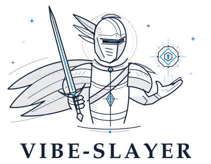
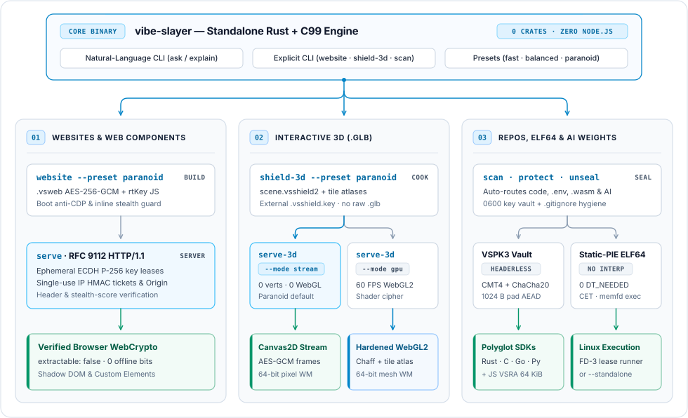

<p align="center">
  <picture>
    <source media="(prefers-color-scheme: dark)" srcset="assets/vibeslayer-hero-dark.svg" />
    <source media="(prefers-color-scheme: light)" srcset="assets/vibeslayer-hero-light.svg" />
    
  </picture>
</p>

<h1 align="center">Vibe-Slayer</h1>

<p align="center">
  <a href="https://github.com/HUSMUS9999/vibe-slayer/releases/tag/v1.0.0-beta.3"></a>
  <a href="#architecture--packages"></a>
  <a href="#architecture--packages"></a>
  <a href="#quickstart"></a>
  <a href="LICENSE"></a>
</p>

<p align="center">
  <a href="#quickstart">Quickstart</a> &middot;
  <a href="#architecture--packages">Architecture</a> &middot;
  <a href="#benchmarks">Benchmarks</a> &middot;
  <a href="#threat-model--boundaries">Threat Model</a> &middot;
  <a href="#documentation">Docs</a>
</p>

**Vibe-Slayer** compiles to a single standalone Rust + C99 binary with zero external crates or runtime dependencies for protecting live websites & Web Components, interactive 3D models, native Linux ELF64 binaries, AI model weights, and source repositories.

## Problem & Solution

**Problem:** Static obfuscators were built to slow down human readers, not AI reversing agents, CDP scrapers, or WebGL rippers. Heavy AST transforms inflate bundles by 10×–160× while leaving JavaScript callable offline via a one-line `require()`, `.glb` meshes exposed in browser RAM, `.rodata` secrets readable on disk, and AI weights stored in plaintext.

**Solution:** Vibe-Slayer replaces static obscurity with cryptographic and server-side boundaries in one standalone binary: `AES-256-GCM` web delivery bound to non-extractable `ECDH P-256` leases (`0` offline bits, opt-out decoy bloat), zero-geometry encrypted 3D pixel streaming (`0` vertices, UVs, or WebGL sent to clients), static-PIE `ELF64` wrappers (`Intel CET` + sealed `memfd_create`, plus `memfd_secret` in freestanding vault mode), headerless `VSPK3` file vaults, and `O(1)` 64 KiB random-access `VSRA` AEAD chunks for AI weights. See **[Vision, Architecture & Benchmarks](docs/vision-and-benchmarks.md)** for methodology and trade-offs.

## Features

- **Natural-Language CLI (`explain` & `ask`)**: Preview generated commands safely (`dry-run`) or execute end-to-end protection for sites, 3D models, binaries, and repos without memorizing flags.
- **Live Websites & Web Components (`.vsweb`)**: `AES-256-GCM` encrypted assets decrypted only with live non-extractable `ECDH P-256` WebCrypto leases, supporting Shadow DOM / Custom Elements and offline-dead runtime-keyed JS.
- **Anti-Stealth Browser Detection (`--anti-stealth`)**: Detects C++-patched anti-detect and fingerprint-noise browsers across loader probes, server attestation, and inline `.mjs` guards, alongside `Runtime.enable` CDP traps.
- **Zero-Geometry 3D Streaming (`--mode stream`)**: Renders PBR frames server-side and streams `AES-256-GCM` frames tagged with an invisible 64-bit forensic buyer watermark (`0` vertices, UVs, textures, shaders, or WebGL sent to clients), plus optional 60 FPS WebGL2 `--mode gpu`.
- **Native ELF64, WASM & AI Weight Vaults**: Static-PIE Linux wrappers (`0` `PT_INTERP`/`DT_NEEDED`, Intel CET `IBT+SHSTK`, sealed `memfd_create` / `memfd_secret`), headerless `VSPK3` (`CMT4` + `ChaCha20-Poly1305`), and `O(1)` 64 KiB random-access `VSRA` containers for `.safetensors`.
- **RFC 9112 Server & Polyglot SDKs**: Built-in multi-threaded Rust HTTP/1.1 server compatible with Nginx, Caddy, and Cloudflare, backed by wire-compatible Rust, C/C++, Go, Python, and zero-dependency Node.js SDKs.

---

## Quickstart

### 1. Build Standalone Binary (Zero Crates)

```bash
git clone https://github.com/HUSMUS9999/vibe-slayer.git
cd vibe-slayer
cargo build --release --manifest-path vibeslayer-native-core/rust_core/Cargo.toml
cp vibeslayer-native-core/rust_core/target/release/vibe-slayer ./vibe-slayer
```

### 2. Start in Natural Language (`explain` & `ask`)

Preview any command safely (`dry-run`) with `explain`, or run immediately with `ask`:

```bash
# Run the built-in end-to-end sandbox demo right away
./vibe-slayer ask "show me a demo"

# Preview the exact generated command first (zero changes on disk)
./vibe-slayer explain "protect my website ./dist and block stealth browsers on port 8080"

# Protect a website / Web Components app and block anti-detect browsers
./vibe-slayer ask "protect my website ./dist and block stealth browsers on port 8080"

# Stream a 3D model with zero client-side geometry
./vibe-slayer ask "stream my 3d model ./hero.glb without sending geometry"

# Scan a repository for leaked API keys / .env secrets
./vibe-slayer ask "scan ./my-repo for leaked api keys"
```

### 3. Explicit CLI Workflows

```bash
# Live Website & Web Components (Paranoid: offline-dead rtKey JS + anti-CDP + strict anti-stealth)
./vibe-slayer website ./my-web-app -o ./my-web-app-protected --preset paranoid --origin http://127.0.0.1:8080
./vibe-slayer serve ./my-web-app-protected --preset paranoid --addr 127.0.0.1:8080 --origin http://127.0.0.1:8080

# 3D Model Zero-Geometry Encrypted Pixel Stream (0 vertices / 0 WebGL sent to client)
./vibe-slayer shield-3d --in ./model.glb --out ./model-shielded --key-file ./model.vsshield.key --preset paranoid
./vibe-slayer serve-3d ./model-shielded --preset paranoid --key-file ./model.vsshield.key --addr 127.0.0.1:8790 --origin http://127.0.0.1:8790

# Repository, Secrets & Compiled Linux ELF64 Protection
./vibe-slayer scan ./my-repo
./vibe-slayer ./my-repo
./vibe-slayer test ./my-repo-protected
./vibe-slayer unseal ./my-repo-protected -o ./restored

# Editable JSON Configuration Template
./vibe-slayer init-config --preset paranoid -o vibeslayer.config.json
```

---

## Architecture & Packages

<p align="center">
  <picture>
    <source media="(prefers-color-scheme: dark)" srcset="assets/vibeslayer-arch-dark.svg" />
    <source media="(prefers-color-scheme: light)" srcset="assets/vibeslayer-arch-light.svg" />
    
  </picture>
</p>

| Component | Path | Language & Deps | Role |
| :--- | :--- | :--- | :--- |
| **Standalone CLI & Servers** | [`vibeslayer-native-core/`](vibeslayer-native-core/README.md) | Rust + C99 (**0 crates**) | `./vibe-slayer` (`ELF64`, optional `PE32+`), `libvibeslayer.so`/`.dll`, Rust/C/Go/Python SDKs |
| **Multi-Platform JS Suite** | [`vibeslayer-suite/`](vibeslayer-suite/README.md) | Node.js `>=20` (**0 npm deps**) | 7 product targets (Web, WASM, 3D, Native, Desktop, Mobile, AI `VSRA`) + Web Component `antiStealth` |
| **API Policy Gateway** | [`vibeslayer-policy-kit/`](vibeslayer-policy-kit/README.md) | Node.js `>=20` (**0 npm deps**) | Source-configured `public-preview` / `server-only` / `client-sealed` gateway + `antiStealth` enforcement |

---

## Benchmarks

Every table below was measured live on identical inputs on the same Linux `x86_64` host (`python3 benchmarks/run_unbiased_benchmark.py`, raw data in [`benchmarks/results.json`](benchmarks/results.json)). Node.js comparison tools execute in a single warm process so V8 startup is not billed to `esbuild` or `terser`, and Vibe-Slayer web rows disclose both per-asset `.vsweb` size and the shared one-time `loader.js` payload.

### 1. JavaScript Delivery & Protection (`878 B` pricing & license module)

| Tool | Asset Size (+Loader) | Build | Offline Dead? | Static CDN? | Trade-Off |
| :--- | ---: | :-: | :-: | :-: | :--- |
| **Raw Unprotected JS** | `878 B` (`1.00×`) | `0.0 ms` | No | **Yes** | Baseline control; plaintext source |
| **`esbuild` (`--minify`)** | **`527 B`** (`0.60×`) | `2.4 ms` | No | **Yes** | Fastest & smallest static bundle; minification only |
| **`terser` (`compress+mangle`)** | `534 B` (`0.61×`) | `8.9 ms` | No | **Yes** | Standard minifier; zero offline defense |
| **`javascript-obfuscator` (default)** | `2,169 B` (`2.47×`) | `48.9 ms` | No | **Yes** | Static CDN; leaves literals readable & callable offline |
| **`javascript-obfuscator` (high)** | `5,733 B` (`6.53×`) | `35.7 ms` | No | **Yes** | Hides static literals; still callable offline via `require()` |
| **`js-confuser` (`medium`)** | `147,313 B` (`167.78×`) | `889.1 ms` | No | **Yes** | Heavy AST/CF bloat (`42.8 ms` exec); still callable offline |
| **`Vibe-Slayer` (`.vsweb fast`)** | **`906 B`** `+8.4 KB` | **`1.6 ms`** | **Yes (`0` bits)** | No (`serve`) | `+28 B`/asset AES-256-GCM + shared `loader.js`; needs runtime server |
| **`Vibe-Slayer` (`.vsweb paranoid`)** | `102,783 B` `+12.1 KB` | `1.9 ms` | **Yes (`0` bits)** | No (`serve`) | Adds fixed `96 KB` opt-out decoy VM (`--js-bloat-kb`) + `rtKey` JS + inline guard |

### 2. Native Linux `ELF64` Binary (`15,992 B` `gcc -O2` C binary)

| Tool | Binary Size | Cold Start | `.rodata` Hidden? | Trivial Unpack? | Trade-Off |
| :--- | ---: | :-: | :-: | :-: | :--- |
| **Raw `gcc -O2` ELF64** | `15,992 B` (`1.00×`) | `0.388 ms` | No | Yes | Baseline unstripped ELF64 |
| **`strip --strip-all`** | `14,480 B` (`0.91×`) | **`0.349 ms`** | No | Yes | Fastest; leaves `.rodata` & disassembly plaintext |
| **`UPX 4.2.4` (`--best`)** | **`5,348 B`** (`0.33×`) | `0.442 ms` | **Yes** | Yes (`9.7 ms`) | Shrinks binary `67%`; `upx -d` restores exact binary |
| **`Vibe-Slayer` (Static-PIE + CET)** | `273,544 B` (`17.11×`) | `2.169 ms`* | **Yes** | **No** | `0` `PT_INTERP`/`DT_NEEDED`, Intel CET + sealed `memfd_create`; adds ~`260 KB` stub & requires lease key |

*\*Measured end-to-end via `./vibe-slayer run` CLI launcher; direct freestanding FD-3 unseal is ~`0.89 ms`.*

### 3. AI Model Weights (`.safetensors`, `262,240 B` FP32 tensor)

| Tool | Output Size | Median Time | `O(1)` Chunk Seek? | Raw FP32 Hidden? | Trade-Off |
| :--- | ---: | :-: | :-: | :-: | :--- |
| **Raw `.safetensors`** | `262,240 B` (`1.0000×`) | **`0.022 ms`** | **Yes** | No | In-process mmap baseline; plaintext weights on disk |
| **OpenSSL AES-256-CBC** | `262,256 B` (`1.0001×`) | `2.761 ms` | No (`O(N)`) | **Yes** | Unauthenticated CBC; full-file CLI decrypt required |
| **`Vibe-Slayer` (`VSPK3` whole-file)** | `263,260 B` (`1.0039×`) | `1.661 ms`* | No (`O(N)`) | **Yes** | Headerless key-committing `CMT4` + `ChaCha20-Poly1305` (C SDK peak ~`3.2 GiB/s` L3-hot) |
| **`Vibe-Slayer` (`VSRA` 64 KiB chunks)** | `327,869 B` (`1.2503×`)† | `1.670 ms` | **Yes (`O(1)`)** | **Yes** | `vibeslayer-suite` 64 KiB chunked AEAD + per-lease watermark (in-process median) |

*\*CLI full-file unseal time includes Rust process spawn. †`262,240 B` = `4 × 64 KiB + 96 B` `.safetensors` header; the 5th partial chunk pads to 64 KiB (`< 0.01%` padding on multi-GB models).*

### 4. Runtime Server, 3D & Anti-Stealth Measurements

Full details in **[Vision & Benchmarks](docs/vision-and-benchmarks.md)** and the 19-browser test matrix in **[VeilBreak](https://github.com/HUSMUS9999/veilbreak)**:

| Subsystem | Measured Result | Scope / Notes |
| :--- | :--- | :--- |
| **`vibe-slayer serve` — ECDH Lease / `.vsweb` Delivery** | `58,619` leases/s · `196,205` req/s | Multi-threaded pure-Rust HTTP/1.1 keep-alive pool (`localhost`) |
| **C SDK (`libvibeslayer.so`) `vs_unseal_vspk3`** | `3,294 MiB/s` (L3-hot) | Wire-compatible `CMT4` + `ChaCha20-Poly1305` across Rust/C/Go/Python |
| **3D Stream (`--mode stream`, `1280×820`, 53k tris)** | `23.7 ms` RTT (`~42 FPS` cap) | Server software PBR + invisible 64-bit WM (`0.999` conf) + JPEG + AES-GCM |
| **3D GPU (`--mode gpu`, `581 KB` `.glb` → `750 KB`)** | `0.984 ms` blind `WM64` decode | `64/64` bits recovered under `±2` LSB coordinate noise |
| **Anti-Stealth Live Verification** | Chrome 158 & Firefox 153 ESR: `0` FP · CloakBrowser 146: `11/11` denied | Tested on unmodified desktop controls vs. CloakBrowser 146 (see caveats below) |

---

## Threat Model & Boundaries

| Threat Tier | Website & Web Components (`paranoid`) | 3D Stream (`paranoid`, `--mode stream`) |
| :--- | :--- | :--- |
| **Tier 1: `curl` / `wget` / Static Scrapers** | **Blocked (`0` plaintext served):** empty HTML shell, `.vsweb` AES-256-GCM blobs, `403` manifest | **Blocked:** zero 3D files or WebGL endpoints exist |
| **Tier 2: Playwright / Puppeteer / Selenium** | **Blocked before lease:** `AUTOMATION_DENIED` via `navigator.webdriver`, `Runtime.enable`, and headless UA checks | **Blocked before init:** `AUTOMATION_DENIED`, `0` frames rendered |
| **Tier 3: AI-Agent CDP Reversers** | **Blocked by default (`Runtime.enable` trap):** if patched out and `blob:` JS is dumped, extracted JS is offline-dead (`VS_RUNTIME_KEY_REQUIRED`) + optional `96 KB` decoy VM | **Geometry withheld (`0` mesh/UV/shader/WebGL sent):** wire frames are `AES-256-GCM` ciphertext carrying a blind 64-bit forensic buyer watermark |
| **Tier 4a: Fingerprint-Noise Anti-Detect Browsers (CloakBrowser 146)** | **Denied (`STEALTH_BROWSER_DENIED`):** blocked at loader, server attestation (`403`), and inline inside hardened `.mjs` Web Components | **Denied (`STEALTH_BROWSER_DENIED`):** `0` handshakes in both `strict` and `balanced` |
| **Tier 4b: Custom Zero-Noise Patched Chromium + Human** | **Irreducible client-JS boundary:** code executing in a browser an attacker builds from C++ source can be read from V8 RAM. Keep true secrets server-only via [`vibeslayer-policy-kit`](vibeslayer-policy-kit/README.md) | **No mesh/UV/PBR recovery:** attacker receives only rate-limited, single-in-flight, focal/tilt-drifted 2D frames, each carrying a blind 64-bit buyer watermark |

**Important operational boundaries:**
- **`VS_ATTEST_V1` attestation** is an unkeyed SHA-256 payload digest (anti-tamper / replay-check helper, not a cryptographic client secret). Pair with `--auth-hmac-key` for HMAC-authenticated sessions.
- **Privacy browsers & DevTools:** `--anti-stealth strict` (`>= 2`) can flag Canvas/Audio/DOMRect noise in Brave Shields, Tor Browser, or Firefox `privacy.resistFingerprinting`, and open browser DevTools can trip `--anti-cdp`. Use `--preset balanced` (`--anti-stealth balanced`, threshold `>= 4`) for broad public consumer traffic.
- **`--mode gpu` vs. `--mode stream`:** `--mode gpu` eliminates static `.glb` downloads and normal-oracle leaks while preserving 60 FPS WebGL2 and server-baked 64-bit vertex watermarking, but multi-view GPU capture can still approximate unwatermarked geometry up to Kruppa/SVD error; use `--mode stream` whenever raw 3D geometry must never reach the client.

---

## Documentation

| Audience | Guide | Topics |
| :--- | :--- | :--- |
| **Beginners** | **[Natural-Language Beginner's Guide](docs/getting-started-beginners.md)** | `./vibe-slayer ask` and `explain` with copy-paste everyday recipes |
| **Evaluators & Architects** | **[Vision & Head-to-Head Benchmarks](docs/vision-and-benchmarks.md)** | Why static obfuscation breaks vs. AI agents + full multi-domain benchmark data |
| **Frontend & Web Devs** | **[Live Websites & Web Components](docs/web-and-web-components.md)** | Standalone `.vsweb` ECDH P-256 runtime, Shadow DOM, `--harden-js`, `--anti-cdp`, and `--anti-stealth` |
| **3D & Spatial Teams** | **[3D Shield & Encrypted Stream](docs/3d-shield-and-stream.md)** | `--mode stream` (zero-geometry AES-GCM frames) vs. `--mode gpu` (60 FPS WebGL2) & 64-bit forensic tracing |
| **Backend & Systems** | **[Native Binaries & Polyglot SDKs](docs/native-binaries-and-sdks.md)** | Repo auto-classification, static-PIE ELF64 (`CET` + `memfd_create`/`memfd_secret`), and Rust/C/Go/Python/JS SDKs |
| **DevOps & SecOps** | **[Deployment & Security Proxies](docs/deployment-and-security-proxies.md)** | RFC 9112 proxy compliance, Nginx/Caddy configs, `--trust-proxy`, and security proxy troubleshooting |
| **Power Users** | **[CLI Reference & Configuration](docs/cli-and-configuration.md)** | Every subcommand, preset matrix, `vibeslayer.config.json` schema, and environment variables |
| **Security Auditors** | **[Threat Model & Empirical Proofs](docs/threat-model-and-benchmarks.md)** | Tier 1–4 adversary matrix, 6 anti-stealth invariants, caveats, and irreducible boundaries |

---

## Ecosystem

- **[Vibe-Slayer](https://github.com/HUSMUS9999/vibe-slayer)** *(this repository)* — Full-stack zero-dependency asset, binary, website/Web Component, AI weight, and 3D stream protection platform.
- **[ProxySnare](https://github.com/HUSMUS9999/proxysnare)** — Standalone middleware & CLI shield that detects and blocks intercepting HTTP proxies and automated repeaters.
- **[VeilBreak](https://github.com/HUSMUS9999/veilbreak)** — Drop-in browser SDK, `<veil-break>` Shadow DOM Web Component, reverse-proxy middleware, and Python verifier for detecting and blocking anti-detect and stealth browsers across Chromium & Gecko.

---

## Building Everything & Running Tests

### Prerequisites

- **Core binary**: Rust (`rustc` / `cargo`) — zero external crates.
- **Native Linux build + C SDK (`make all`)**: `gcc` (native Linux `x86_64`/`aarch64`). Optional Windows `PE32+` cross-build (`make windows`): `x86_64-w64-mingw32-gcc` and `rustup target add x86_64-pc-windows-gnu`.
- **Companion JS packages**: Node.js `>= 20.0.0` (zero npm dependencies).
- **Full Python verification suite**: Python `>= 3.10` with `cryptography`, `Pillow`, and `tiktoken` (plus Chrome/Chromium for live CDP tests).
- **Optional JS comparison tools for `benchmarks/`**: `npm --prefix benchmarks install` (and optional `upx` in `PATH`).

```bash
# 1. Build Linux ELF64 binary and C SDK shared library (0 compiler warnings)
make -C vibeslayer-native-core all
# Optional: cross-compile Windows PE32+ binaries & DLL
# make -C vibeslayer-native-core windows

# 2. Run Rust unit tests (release)
cargo test --manifest-path vibeslayer-native-core/rust_core/Cargo.toml --release

# 3. Run full polyglot, CLI, 3D shield/stream, red-team, and proxy test suite
make -C vibeslayer-native-core test
# Optional: run SOTA throughput microbenchmarks
# make -C vibeslayer-native-core bench

# 4. Run companion Node.js suites (including Web Component antiStealth tests)
npm test --prefix vibeslayer-suite
npm test --prefix vibeslayer-policy-kit

# 5. Reproduce the multi-domain benchmark vs. esbuild, terser, javascript-obfuscator, js-confuser, strip, UPX & OpenSSL
npm --prefix benchmarks install
python3 benchmarks/run_unbiased_benchmark.py
```

---

## License

MIT License — see [LICENSE](LICENSE).
