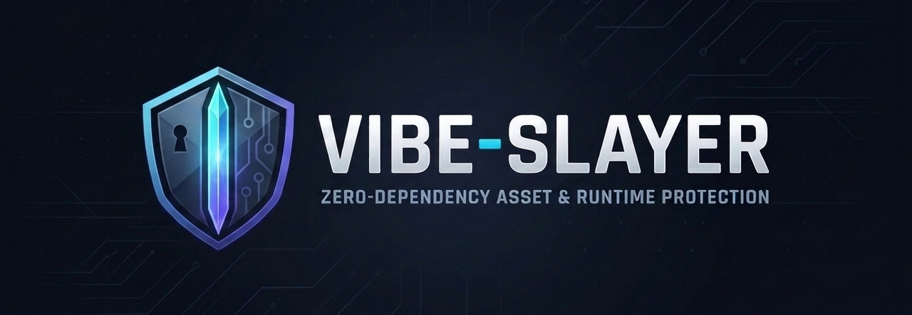

<p align="center">
  
</p>

<p align="center">
  <a href="#architecture--packages"></a>
  <a href="docs/getting-started-beginners.md"></a>
  <a href="docs/web-and-web-components.md"></a>
  <a href="docs/web-and-web-components.md#5-live-verification-cloakbrowser-146-vs-chrome-158"></a>
  <a href="docs/deployment-and-security-proxies.md"></a>
</p>

**Zero-dependency compiled Rust + C99 protection platform for repositories, native Linux binaries, live websites & Web Components, AI weights, and interactive 3D models — built for the era of AI reversing agents ("vibe reversing") and anti-detect browsers.**

`vibe-slayer` compiles to a **single standalone binary** with **zero external Rust crates** and **zero Node.js runtime dependency**, backed by wire-compatible native SDKs for **Rust, C/C++, Go, and Python** plus companion zero-dependency Node.js packages (`vibeslayer-suite`, `vibeslayer-policy-kit`).

---

## Why Vibe-Slayer Exists (The Vision)

Traditional obfuscators were built to slow down human reverse engineers reading static code. Against modern **AI coding/reversing agents**, **CDP scrapers**, **WebGL rippers**, and **C++-patched stealth browsers (like CloakBrowser)**, static obfuscation collapses:

- **Static chaff bloats your users, not attackers**: Classic obfuscators inflate a `100 B` WebAssembly module to **`6.88 MB` (`68,801×`)** or a `16 KB` binary to **`1.18 MB`** while leaving `.rodata` secrets, `\0asm` headers, or raw AI model weights readable at rest — and an LLM agent simply runs a 15-line runtime hook to dump plaintext in seconds.
- **3D & Web Components ship naked**: Standard `.glb` viewers stream complete meshes and textures straight to browser RAM/WebGL; static websites serve raw source to `curl` and Playwright.
- **Anti-detect browsers bypass naive bot checks**: Tools like CloakBrowser strip `navigator.webdriver` and CDP leaks directly inside C++.

**Vibe-Slayer replaces obscurity with real cryptographic and physical boundaries**:
1. **Standard 256-bit AEAD everywhere** (`AES-256-GCM` `.vsweb` + headerless key-committing `VSPK3` `CMT4` + `ChaCha20-Poly1305`) — zero plaintext magic headers, zero keys on disk.
2. **Zero-geometry 3D pixel streaming (`--mode stream`)** — `0` vertices, `0` UVs, `0` textures, `0` shaders, and `0` WebGL contexts ever reach the client; every frame arrives `AES-256-GCM`-encrypted with a visually invisible 64-bit forensic buyer watermark.
3. **Physics-invariant anti-CloakBrowser defense (`--anti-stealth`)** — 6 hardware/physics invariants enforced at the loader, server SHA-256 attestation, and inline inside every hardened `.js`/`.mjs` Web Component.
4. **Plain-English beginner ergonomics (`ask` / `explain`)** — anyone can secure a site, 3D asset, or repo without memorizing security flags.

Read the full **[Vision, Architecture & Benchmarks](docs/vision-and-benchmarks.md)**.

---

## Documentation Index

| Audience | Guide | What You'll Find |
| :--- | :--- | :--- |
| **Beginners** | **[Plain-English Beginner's Guide](docs/getting-started-beginners.md)** | Use `./vibe-slayer ask "..."` and `explain "..."` with zero jargon + copy-paste everyday recipes |
| **Evaluators & CTOs** | **[Vision & Head-to-Head Benchmarks](docs/vision-and-benchmarks.md)** | Why obfuscation failed vs. AI agents + real measured benchmarks against `BLA v3.2.1` |
| **Frontend & Web Devs** | **[Live Websites & Web Components](docs/web-and-web-components.md)** | Zero-Node `.vsweb` ECDH P-256 runtime, Shadow DOM / Custom Elements, `--harden-js`, `--anti-cdp`, and `--anti-stealth` CloakBrowser denial |
| **3D & Spatial Teams** | **[3D Shield & Encrypted Stream](docs/3d-shield-and-stream.md)** | `--mode stream` (zero-geometry AES-GCM frames) vs. `--mode gpu` (60 FPS WebGL2 cipher) & 64-bit forensic tracing |
| **Backend & Systems** | **[Native Binaries & Polyglot SDKs](docs/native-binaries-and-sdks.md)** | Repo auto-classification, static-PIE ELF64 (`CET` + `memfd_secret`), and Rust/C/Go/Python/JS SDK examples |
| **DevOps & SecOps** | **[Deployment & Security Proxies](docs/deployment-and-security-proxies.md)** | RFC 9112 proxy compliance, Nginx/Caddy configs, `--trust-proxy`, Caido/Burp testing & error-code troubleshooting |
| **Power Users** | **[CLI Reference & Configuration](docs/cli-and-configuration.md)** | Every subcommand, preset matrix, `vibeslayer.config.json` schema, and environment variables |
| **Security Auditors** | **[Threat Model & Empirical Proofs](docs/threat-model-and-benchmarks.md)** | Honest Tier 1–4 adversary matrix, all 6 CloakBrowser hardware invariants, and irreducible browser boundaries |

---

## Easiest Way to Start: Plain English (`ask` & `explain`)

No flags to memorize — tell Vibe-Slayer what you want in everyday English. Use `explain` to preview safely (`dry-run`), or `ask` to execute immediately:

```bash
# Preview the exact command & plain-English explanation first (zero changes on disk)
./vibe-slayer explain "protect my website ./dist and block cloakbrowser on port 8080"

# Protect a website / Web Components app and deny CloakBrowser
./vibe-slayer ask "protect my website ./dist and block cloakbrowser on port 8080"

# Protect & prepare a 3D model for zero-geometry encrypted pixel streaming
./vibe-slayer ask "stream my 3d model ./hero.glb without sending geometry"

# Audit a repository for leaked API keys / .env secrets
./vibe-slayer ask "scan ./my-repo for leaked api keys"

# Run the built-in end-to-end sandbox demo
./vibe-slayer ask "show me a demo"
```

---

## 60-Second Explicit CLI Quickstart

```bash
# 1. Live Website & Web Components (Paranoid: offline-dead rtKey JS + anti-CDP + anti-CloakBrowser strict)
./vibe-slayer website ./my-web-app -o ./my-web-app-protected --preset paranoid --origin http://127.0.0.1:8080
./vibe-slayer serve ./my-web-app-protected --preset paranoid --addr 127.0.0.1:8080 --origin http://127.0.0.1:8080

# 2. 3D Model Zero-Geometry Encrypted Pixel Stream (0 vertices / 0 WebGL sent to client)
./vibe-slayer shield-3d --in ./model.glb --out ./model-shielded --key-file ./model.vsshield.key --preset paranoid
./vibe-slayer serve-3d ./model-shielded --preset paranoid --key-file ./model.vsshield.key --addr 127.0.0.1:8790 --origin http://127.0.0.1:8790

# 3. Repository, Secrets & Compiled Linux ELF64 Protection
./vibe-slayer scan ./my-repo
./vibe-slayer ./my-repo
./vibe-slayer test ./my-repo-protected
./vibe-slayer unseal ./my-repo-protected -o ./restored

# 4. Editable JSON Configuration Template
./vibe-slayer init-config --preset paranoid -o vibeslayer.config.json
```

---

## Architecture Overview

```mermaid
flowchart TB
    CLI["vibe-slayer (Standalone Rust Binary, 0 Crates + Plain-English ask/explain)"]

    subgraph WEB["Live Websites & Web Components"]
        W1["website --preset paranoid"] --> W2[".vsweb AES-256-GCM Blobs + Offline-Dead rtKey JS + Inline Anti-Stealth Guard"]
        W2 --> W3["serve (RFC 9112 Rust HTTP/1.1)"]
        W3 -->|"ECDH P-256 + Anti-CDP + Tier-4 Attest"| W4["Browser WebCrypto (extractable: false)"]
    end

    subgraph D3["3D Models (.glb)"]
        G1["shield-3d --preset paranoid"] --> G2["Encrypted Geometry + Scrambled Tile Atlas + External .vsshield.key"]
        G2 --> G3["serve-3d --mode stream (default paranoid)"]
        G2 --> G4["serve-3d --mode gpu (60 FPS WebGL2)"]
        G3 -->|"AES-256-GCM JPEG Frames + Blind 64-bit WM"| G5["Zero-Geometry Canvas2D Client"]
    end

    subgraph REPO["Repos, Binaries & SDKs"]
        R1["protect / scan / test / unseal"] --> R2["VSPK3 (Code, .env, .wasm, AI Weights)"]
        R1 --> R3["Static-PIE ELF64 Wrapper (CET + memfd_secret)"]
        R2 --> R4["Wire-Compatible SDKs: Rust, C/C++, Go, Python, JS"]
    end

    CLI --> WEB
    CLI --> D3
    CLI --> REPO
```



---

## Real Measured Benchmarks vs. Other Tools

All comparisons below were measured directly on identical unprotected inputs against **`BLA v3.2.1 --intensity bankrupt`** and raw baselines (see **[Vision & Benchmarks](docs/vision-and-benchmarks.md)** for full methodology):

| Target | Raw Size | `BLA v3.2.1` (`bankrupt`) | `Vibe-Slayer` (Measured) |
| :--- | ---: | :--- | :--- |
| **Web JS Bundle** | `116 B` | `130,098 B` (`1,121.5×`); callable offline via 1-line import | **`233 B` (`2.01×`, `558×` smaller)**; `AES-256-GCM` + non-extractable `ECDH P-256`; `2.11 ms` unseal; `0` offline bits |
| **WASM Module** | `100 B` | `6,880,116 B` (`68,801×`); `\0asm` exposed; `9.34 ms` boot | **`220 B` (`2.20×`, `31,273×` smaller)**; `\0asm` hidden; **`0.91 ms`** unseal+instantiate (`10.2×` faster) |
| **3D `.glb` Model** | `581 KB` | **Unsupported (`exit 1`)** | **`750 KB` (`1.29×`)** cooked `VS3D` + `64/64` `WM64` (`0.984 ms` decode under `±2` LSB noise); or **`--mode stream`** (`0` geometry sent, `23.7 ms` RTT at `1280×820`) |
| **Native Linux `ELF64`** | `16.0 KB` | `1,180.9 KB` (`73.8×`); `.rodata` plaintext; `1,952` `.text` tokens | **`169.0 KB` (`6.99×` smaller)**; `0` `PT_INTERP`/`DT_NEEDED`; Intel CET + `memfd_secret`; `0.891 ms` cold start; **`902,988` live `.text` tokens (`462.6×`)** |
| **AI Weights (`.safetensors`)** | `262 KB` | `272 KB` (`1.04×`); raw FP32 weights **100% plaintext** | **`262.3 KB` (`1.0003×`)**; `O(1)` 64 KiB random-access AEAD (`1.56 ms`); `0` raw floats exposed |
| **Runtime Server Throughput** | — | N/A | **`58,619` ECDH leases/s** · **`196,205` `.vsweb` req/s** · **`3,294 MiB/s`** C SDK `VSPK3` unseal |
| **Live CloakBrowser 146 vs. Chrome 158** | — | N/A | **CloakBrowser 146: `100%` Denied (`11/11`, `0` leases, `0` Web Components)** · **Chrome 158: `0/11` (`0` false positives)** |

---

## Honest Security Assessment (No Hype)

| Threat Tier | Website & Web Components (`paranoid`) | 3D Stream (`paranoid`) |
| :--- | :--- | :--- |
| **Tier 1: `curl` / `wget` / Static Scrapers** | **100% Blocked** (empty shell, `.vsweb` AES-256-GCM, `403` manifest) | **100% Blocked** (`0` 3D files exposed) |
| **Tier 2: Playwright / Puppeteer / Selenium** | **100% Blocked before lease** (`AUTOMATION_DENIED`) | **100% Blocked before init** (`AUTOMATION_DENIED`) |
| **Tier 3: AI-Agent CDP Reversers** | **Blocked by `Runtime.enable` trap**; dumped JS is offline-dead (`VS_RUNTIME_KEY_REQUIRED`) + `96 KB` decoy VM | **~100% Geometry Blocked** (`0` verts/UVs/textures/shaders/WebGL; AES-GCM wire + `0.999+` blind 64-bit WM) |
| **Tier 4a: Anti-Detect Browsers (CloakBrowser 146)** | **100% Denied (`STEALTH_BROWSER_DENIED`)** at loader, server attestation, AND inline inside extracted hardened `.mjs` Web Components | **100% Denied (`STEALTH_BROWSER_DENIED`)** (`0` handshakes in both `strict` and `balanced`) |
| **Tier 4b: Custom Zero-Noise Patched Chromium + Human** | **Irreducible client-JS boundary**: keep truly secret keys/formulas server-only via [`vibeslayer-policy-kit`](vibeslayer-policy-kit/README.md) | **No mesh/UV/PBR recovery**: only rate-limited, single-in-flight, focal/tilt-drifted 2D frames, every one carrying a blind 64-bit buyer watermark |

---

## Ecosystem & Companion Standalone Repositories

- **[Vibe-Slayer](https://github.com/HUSMUS9999/vibe-slayer)** *(this repository)* — Full-stack zero-dependency asset, binary, website/Web Component, AI weight, and 3D stream protection platform.
- **[ProxySnare](https://github.com/HUSMUS9999/proxysnare)** — Dedicated standalone middleware & CLI shield that detects and blocks intercepting HTTP proxies and repeaters (**Caido Repeater**, **Burp Suite Repeater**, **mitmproxy**).
- **[CloakGate](https://github.com/HUSMUS9999/cloakgate)** — Dedicated drop-in browser SDK, `<cloak-gate>` Web Component, and reverse-proxy middleware for detecting and blocking **CloakBrowser** and anti-detect browsers in 60 seconds.

---

## Architecture & Packages

| Component | Path | Language & Dependencies | Role |
| :--- | :--- | :--- | :--- |
| **Standalone CLI & Servers** | [`vibeslayer-native-core/`](vibeslayer-native-core/README.md) | Rust + C99 (**0 crates**) | `./vibe-slayer` (`ELF64` & `PE32+`), `libvibeslayer.so`/`.dll`, Rust/C/Go/Python SDKs |
| **Multi-Platform JS Suite** | [`vibeslayer-suite/`](vibeslayer-suite/README.md) | Node.js `>=20` (**0 npm deps**) | 7 product targets (Web, WASM, 3D, Native, Desktop, Mobile, AI) + `antiStealth` Web Component protection |
| **API Policy Gateway** | [`vibeslayer-policy-kit/`](vibeslayer-policy-kit/README.md) | Node.js `>=20` (**0 npm deps**) | Source-configured `public-preview` / `server-only` / `client-sealed` gateway + `antiStealth` enforcement |

---

## Build Prerequisites & Running All Test Suites

### Prerequisites
- **Building from source (`make all`)**: Rust (`rustc`/`cargo`), `gcc` (Linux C SDK), and optional `x86_64-w64-mingw32-gcc` + `rustup target add x86_64-pc-windows-gnu` for Windows cross-builds.
- **Companion JS packages**: Node.js `>= 20.0.0` (zero npm dependencies).
- **Full Python verification suite**: Python `>= 3.10` with `cryptography` and `Pillow` (plus Chrome/Chromium for live CDP tests).

```bash
# 1. Build Linux ELF64, Windows PE32+, and C SDK (0 compiler warnings)
make -C vibeslayer-native-core all

# 2. Run Rust unit tests (release)
cargo test --manifest-path vibeslayer-native-core/rust_core/Cargo.toml --release

# 3. Run full polyglot, CLI, 3D shield/stream, red-team, proxy, and SOTA benchmark suite
make -C vibeslayer-native-core test

# 4. Run companion Node.js suites (including Web Component antiStealth tests)
npm test --prefix vibeslayer-suite
npm test --prefix vibeslayer-policy-kit
```
