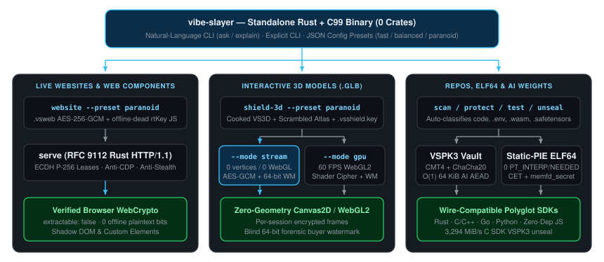

<p align="center">
  
  
</p>

<p align="center">
  <strong>Modular audited cryptography, zero-geometry 3D streaming, blind forensic watermarking, and streaming AEAD vaults in a <code>#![forbid(unsafe_code)]</code> Rust workspace + C99/Go/Python/JS SDKs.</strong>
</p>

<p align="center">
  <a href="https://github.com/HUSMUS9999/vibe-slayer/releases"></a>
  <a href="https://github.com/HUSMUS9999/vibe-slayer/actions/workflows/ci.yml"></a>
  <a href="#architecture"></a>
  <a href="#architecture"></a>
  <a href="LICENSE"></a>
</p>

<p align="center">
  <a href="#quickstart"><strong>Quickstart</strong></a> &nbsp;&middot;&nbsp;
  <a href="#architecture"><strong>Architecture</strong></a> &nbsp;&middot;&nbsp;
  <a href="#performance"><strong>Performance</strong></a> &nbsp;&middot;&nbsp;
  <a href="#security-model--limits"><strong>Security Model</strong></a> &nbsp;&middot;&nbsp;
  <a href="#documentation"><strong>Docs</strong></a>
</p>

**Vibe-Slayer** replaces fragile client-side obfuscation with cryptographic boundaries and server-side execution across interactive 3D models, live web bundles, streaming binary/AI-weight vaults, and source-configured API gateways.

Every core capability is structured as an **independently reusable Rust crate** (`crates/vs-*`) or **zero-dependency npm subpath module** with TypeScript `.d.ts` definitions — use the standalone CLI, embed individual crates into your own Rust backend, or interoperate directly from C99, Go, Python, and Node.js.

## Quickstart

New to the CLI? Start with the **[Plain-English Beginner's Guide](docs/getting-started-beginners.md)**.

### 1. Build & Run the Built-In Self-Verification Demo

Requires Rust (`cargo`). Add `gcc` for the C99 shared library (`libvibeslayer.so`).

```bash
git clone https://github.com/HUSMUS9999/vibe-slayer.git
cd vibe-slayer
cargo build --release --bin vibe-slayer
cp target/release/vibe-slayer ./vibe-slayer

./vibe-slayer demo
```

### 2. Core Workflows

Keys can be supplied via `--key-file <0600-path>`, `--key-stdin`, or `VIBESLAYER_KEY` (avoiding process-list exposure), and all vault outputs commit atomically through `0600` sibling temporary files.

```bash
# 1) Multi-SKU zero-geometry 3D streaming server (0 vertices/UVs/WebGL sent to clients)
./vibe-slayer serve-3d ./models-dir --bind 127.0.0.1:8790 \
  --key-file ./wm.key --auth-key-file ./auth.key --allow-origin https://app.example.com

# Blind forensic trace on a leaked, cropped, scaled, or JPEG-recompressed screenshot
./vibe-slayer trace-3d --image ./leaked.png --key-file ./wm.key

# 2) Authenticated .vsweb v2 web bundle & async Tokio/Axum server
./vibe-slayer website ./dist --out ./site.vsweb --site-id my-app --key-out ./site.key
./vibe-slayer serve ./site.vsweb --bind 127.0.0.1:8080 \
  --key-file ./site.key --auth-key-file ./auth.key

# 3) 64-bit VSPK3 v2 STREAM AEAD + CMT-4 vault (O(1) RAM, >4 GiB capable, Rust/C/Go/Python parity)
./vibe-slayer vault seal ./weights.safetensors -o ./weights.vsp3 \
  --key-file ./vault.key --asset-id llama-7b
./vibe-slayer vault inspect ./weights.vsp3 --key-file ./vault.key --asset-id llama-7b
./vibe-slayer vault unseal ./weights.vsp3 -o ./weights.restored \
  --key-file ./vault.key --asset-id llama-7b

# 4) Scoped IP-agnostic bearer grants & read-only static secret scanner
./vibe-slayer token mint --key-file ./auth.key --subject buyer-42 \
  --aud https://app.example.com --asset-id hero --scope stream:3d --ttl-secs 300
./vibe-slayer scan ./my-repo
```

### 3. Plain-English Commands (`explain` & `ask`)

Powered by the standalone `vs-nl` crate — **100% local deterministic Rust**, zero LLM APIs, zero network calls. Preview safely with `explain`, or run with `ask`:

```bash
./vibe-slayer explain "stream ./hero.glb on port 8790"
./vibe-slayer explain "trace watermark in ./leaked.png"
./vibe-slayer ask "seal ./weights.safetensors"
```

## Architecture

<p align="center">
  
</p>

### Modular Rust Workspace (`#![forbid(unsafe_code)]`)

| Crate / Package | Role | Key Capabilities & Dependencies |
| :--- | :--- | :--- |
| [`crates/vs-crypto`](crates/vs-crypto/Cargo.toml) | Audited Crypto Core | `ring` (BoringSSL) AES-256-GCM & ChaCha20-Poly1305, pubkey-bound P-256 ECDH, latched monotonic `SessionAead`, pre-expanded `StreamAeadKey` / `HmacKey`, constant-time `verify_session_grant`. |
| [`crates/vs-vault`](crates/vs-vault/Cargo.toml) | Streaming Vault Engine | 64-bit Rogaway-Zhang STREAM + Bellare-Hoang CMT-4 (`VSPK3 v2`), `66,656 B` lookahead, `O(1)` random access (`Vspk3V2RandomAccess`), legacy `VSPK2`/`VSPK3 v1` support. |
| [`crates/vs-watermark`](crates/vs-watermark/Cargo.toml) | Blind Forensic Watermarking | Precomputed `WatermarkEngine`, 128×128 2D-FFT phase-correlation sync, mid-band DCT payload + 32-bit keyed HMAC-SHA256 MAC + 2-bit Chase soft decoding, headroom-aware JND, Tardos collusion codebook. |
| [`crates/vs-3d`](crates/vs-3d/Cargo.toml) | Zero-Geometry 3D Renderer | glTF 2.0 PBR (`baseColor`, `metallicRoughness`, `emissive`, `doubleSided`, strip/fan), optically compensated smooth-harmonic anti-3DGS camera perturbation, 192-bin spherical `ViewCoverageBudget`, bounded `AssetCatalog`. |
| [`crates/vs-server`](crates/vs-server/Cargo.toml) | Async Tokio/Axum Server | Feature-split (`features = ["3d", "web"]`) multi-SKU 3D & `.vsweb v2` server, DOM-safe `<vs-3d-viewer>` (zero `innerHTML`), closure-scoped WebCrypto `loader.js`, decompression-bomb limits, CIDR `X-Forwarded-For` rate limiting. |
| [`crates/vs-nl`](crates/vs-nl/Cargo.toml) | Offline NL Translator | Deterministic flag-injection-safe English-to-CLI compiler with POSIX-safe command quoting. |
| [`vibeslayer-native-core/`](vibeslayer-native-core/README.md) | CLI + Polyglot SDKs | Thin feature-gated `vibe-slayer` CLI facade + wire-compatible **C99** (`libvibeslayer.so`), **Go**, and **Python** `VSPK3 v2 STREAM` SDKs. |
| [`vibeslayer-suite/`](vibeslayer-suite/README.md) | Modular JS Protection Suite | Node.js `>= 20` (`0` npm deps), subpath exports + `.d.ts` types: Web, WASM, 3D, Native ELF64, Desktop Enclave, Mobile JNI, and `VSR2` metadata-authenticated `O(1)` safetensors/BF16-safe AI weight chunks. |
| [`vibeslayer-policy-kit/`](vibeslayer-policy-kit/README.md) | Source-Configured API Gateway | Node.js `>= 20` (`0` npm deps), subpath exports + `.d.ts` types: `public-preview` / `server-only` / `client-sealed` gateway, Express + Web Fetch API adapters, CORS, and `antiStealth`. |

## Performance

Measured locally on Linux `x86_64` against release builds (`v2.0.0-alpha.1`) with zero environment data exposed:

| Workload | Measured Result | Engineering Property |
| :--- | :--- | :--- |
| **`VSPK3 v2 STREAM` Seal (`256 MiB`)** | **`1,856–2,085 MiB/s`** (`122.8–137.9 ms`) · **`12.82 MiB` Peak RSS** | Full AEAD ChaCha20-Poly1305 + Bellare-Hoang CMT-4 in `O(1)` constant RAM (`#![forbid(unsafe_code)]`, `ring`) |
| **`VSPK3 v2 STREAM` Unseal (`256 MiB`)** | **`1,991–2,106 MiB/s`** (`121.5–128.6 ms`) · **`13.12 MiB` Peak RSS** | Includes `66,656 B` atomic lookahead + `fsync` sibling temp commit — **1.3× faster than unauthenticated `openssl enc -aes-256-ctr`** (`1,512 MiB/s`, `169.3 ms`) |
| **Built-in `demo` (STREAM + Blind WM + MAC)** | **`5.91 ms` end-to-end** · **`41.0 dB` PSNR** | 64-bit payload + 32-bit keyed HMAC-SHA256 MAC verified blind |
| **Blind Watermark Torture (`vs-watermark`)** | **4/4 Pass (`0.50 s` total suite)** | Intact, 20% arbitrary crop, 85% downscale, and JPEG Q70 recompression verified; flat/1-LSB false-positive rejected |
| **3D Render + Anti-3DGS + Watermark (`vs-3d`)** | **4/4 Pass (`0.10 s` total suite)** | Fixture glTF PBR render + optical tilt-shift `< 0.005` NDC drift + JPEG Q70 crop/scale blind trace |
| **Async `vs-server` Concurrency** | **`200` idle keep-alive sockets + instant `/healthz` (`0.08 s` total suite)** | Non-blocking Tokio/Axum event loop + bounded `render_sem`/`forensics_sem` backpressure |

## Security Model & Limits

- **Audited crypto primitives, pre-1.0 protocol glue ([SECURITY.md](SECURITY.md)):** Every cryptographic primitive in Rust runs on `ring` (BoringSSL constant-time assembly) with `#![forbid(unsafe_code)]`, and HTTP/1.1+HTTP/2 runs on `tokio`/`hyper`/`axum`. The higher-level wire formats (`VSPK3 v2`, `.vsweb v2`, `VSR2`) have not yet received a third-party external audit.
- **Client-side JS is not DRM:** An attacker running a custom Chromium build can inspect decrypted JavaScript or assets in V8 RAM. Keep true secrets behind `vibeslayer-policy-kit` (`server-only`) and keep proprietary 3D meshes strictly on the server with `vs-server` (`serve-3d`).
- **3D pixel streaming vs. screen capture:** `serve-3d` sends `0` vertices, UVs, or shaders to clients and enforces a 192-bin spherical `ViewCoverageBudget` + smooth-harmonic optical perturbations against 3DGS/photogrammetry sweeps, backed by blind 64-bit + 32-bit-MAC forensic watermarking. It cannot physically stop a camera pointed at a screen, but enables post-leak attribution across crops, scaling, and JPEG Q70 compression.
- **`.vsweb v2` scope:** Designed for authenticated app/asset bundles (not public SEO/SSR pages). `/__vibeslayer/lease` fails closed (`401`) unless signed scoped bearer tokens (`web:lease`) are provided or `--allow-anonymous-public-site` is explicitly enabled.

## Documentation

- [Security Policy & Threat Boundaries](SECURITY.md) — Cryptographic audit status and explicit limits.
- [Beginner's Guide](docs/getting-started-beginners.md) — Local `ask` and `explain` recipes.
- [Vision & Benchmarks](docs/vision-and-benchmarks.md) — Design rationale and historical comparisons.
- [Websites & Web Components](docs/web-and-web-components.md) — `.vsweb` runtime and WebCrypto leases.
- [3D Shield & Stream](docs/3d-shield-and-stream.md) — Zero-geometry 3D streaming & blind forensic tracing.
- [Native Binaries & SDKs](docs/native-binaries-and-sdks.md) — Rust, C99, Go, and Python SDK integration.
- [Deployment & Proxies](docs/deployment-and-security-proxies.md) — Reverse-proxy deployment & `--trust-proxy` CIDR rules.

## Development & Verification

Prerequisites: Rust (`cargo`), `gcc`, `Node.js >= 20`, `Go >= 1.21`, and Python `>= 3.10` (`cryptography`).

```bash
cargo clippy --workspace --all-targets -- -D warnings
cargo test --workspace --release
make -C vibeslayer-native-core all
python3 vibeslayer-native-core/tests/test_v2_polyglot.py
(cd vibeslayer-native-core/sdk_go && go test -v ./...)
npm test --prefix vibeslayer-policy-kit
npm test --prefix vibeslayer-suite
```

## Related Projects

- [ProxySnare](https://github.com/HUSMUS9999/proxysnare) — Zero-dependency middleware, reverse proxy, browser guard, and Python verifier for detecting and blocking intercepting HTTP proxies and repeaters.
- [VeilBreak](https://github.com/HUSMUS9999/veilbreak) — Zero-dependency browser integrity SDK, `<veil-break>` Shadow DOM Web Component, reverse-proxy middleware, and Python verifier for anti-detect browsers across Chromium and Gecko.

## License

MIT — see [LICENSE](LICENSE).
