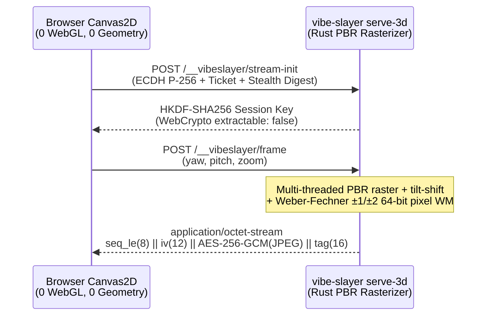

# 3D Model Shield & Encrypted Zero-Geometry Stream

[← Back to README](../README.md) · [Beginner's Guide](./getting-started-beginners.md) · [Web & Web Components](./web-and-web-components.md) · [CLI & Configuration](./cli-and-configuration.md) · [Threat Model](./threat-model-and-benchmarks.md)

Standard 3D web viewers ship raw `.glb`/`.gltf` files directly into browser RAM and WebGL buffers, where a 10-line DevTools hook or Playwright script recovers the entire mesh, UVs, and PBR textures in seconds.

Vibe-Slayer provides **two interactive 3D delivery modes** from the exact same `shield-3d` cooked bundle (`scene.vsshield2` + `tex_*.vsbin` / `stream_tex_*.vsbin`):

1. **`--mode stream` (Default in `--preset paranoid`) — Zero-Geometry Encrypted Pixel Stream**:
   - **0 vertices, 0 indices, 0 UVs, 0 textures, 0 GLSL shaders, 0 WebGL contexts, and 0 projection matrices** ever reach the browser.
   - A multi-threaded pure-Rust software PBR rasterizer renders frames server-side, embeds an imperceptible **post-JPEG blind 64-bit forensic buyer watermark**, and encrypts each frame with per-session **ECDH P-256 + HKDF-SHA256 + AES-256-GCM** (`Content-Type: application/octet-stream`).
2. **`--mode gpu` (Default in `--preset balanced` and `--preset fast`) — Hardened WebGL2 Encrypted-Vertex Viewer**:
   - Runs at native 60 FPS on the client GPU while keeping geometry encrypted at rest (`scene.vsshield2`), injecting decoy chaff triangles (`20%`–`50%`), scrambling textures into per-asset shuffled JPEG/PNG tile grids (`4×4`, `8×8`, `16×16`), serving fused camera matrices per view step, and baking a **server-side 64-bit BPSK forensic buyer watermark** into the vertex stream.
   - **Honest Boundary for `--mode gpu`:** Treat `--mode gpu` as a client-side deterrent + forensic watermark layer. Because the browser GPU still receives encrypted vertices, ephemeral uniforms, and projection matrices to render locally, a determined attacker who captures the shader output and queries `/__vibeslayer/camera` across multiple camera angles can invert the linear projection system and reconstruct Euclidean geometry. Whenever absolute mesh confidentiality is required, use **`--mode stream`**.

---

## 1. Choosing Between `--mode stream` and `--mode gpu`

| Property | `--mode stream` (`paranoid` default) | `--mode gpu` (`balanced` / `fast` default) |
| :--- | :--- | :--- |
| **Mesh / UVs / Textures in Browser** | **Zero** (never leaves the server) | Encrypted + chaff + per-asset scrambled tiles (rendered in WebGL2) |
| **Wire Payload** | `application/octet-stream`: `seq_le(8) \|\| iv(12) \|\| AES-256-GCM(JPEG) \|\| tag(16)` (`AAD = VS3D_FRAME\|<seq>`) | Encrypted vertex chunks + per-asset scrambled tile atlases + ephemeral view uniforms |
| **Defense vs. WebGL / Transform-Feedback / RenderDoc / AI-Agent Mesh Ripping** | **Total** (`0` vertices exist on client) | Raises cost against casual/automated rippers; determined attackers with shader + camera-oracle access can invert geometry (use `--mode stream` for hard secrecy) |
| **Defense vs. Photogrammetry / Multi-View 3DGS** | Compensated tilt-shift `(cx, cy)` + focal/lighting drift + single-in-flight frame serialization + session camera budget | Per-frame camera jitter + session camera budget + zero-normal-oracle |
| **Forensic Buyer Watermark** | Blind post-JPEG 64-bit Weber-Fechner pixel watermark (`trace-stream-frame`, exact uncropped frame) | Server-baked 64-bit BPSK vertex watermark (`trace-shield-3d`, raw lattice vertex stream) |
| **Rendering Latency** | `~20–25 ms` RTT at `1280×820` on 53K-tri PBR mesh (`~40+` interactive FPS) | Native `60 FPS` client GPU |
| **Anti-CDP & Anti-Stealth** | Yes (`--anti-cdp`, `--anti-stealth`, no WebGL required on client) | Yes (`--anti-cdp`, `--anti-stealth`) |

---

## 2. Step-by-Step Workflow

### Step 1: Cook the Protected 3D Bundle (`shield-3d`)

Store the `.vsshield.key` file **outside** the bundle output directory using `--key-file`:

```bash
./vibe-slayer shield-3d \
  --in ./assets/hero_character.glb \
  --out ./dist/hero_shielded \
  --key-file ./secrets/hero.vsshield.key \
  --preset paranoid
```

The command automatically verifies real-vertex accuracy (`maxClipSpaceError`) and chaff triangle clipping immediately after cooking and prints a JSON build report.

### Step 2: Serve in Zero-Geometry Encrypted Stream Mode (`paranoid`)

```bash
./vibe-slayer serve-3d ./dist/hero_shielded \
  --preset paranoid \
  --key-file ./secrets/hero.vsshield.key \
  --addr 127.0.0.1:8790 \
  --origin https://models.example.com \
  --stream-width 1280 \
  --stream-height 820 \
  --title "Hero Character — Protected Preview"
```

### Or Serve in Native 60 FPS Encrypted WebGL2 Mode (`balanced`)

```bash
./vibe-slayer serve-3d ./dist/hero_shielded \
  --preset balanced \
  --mode gpu \
  --anti-stealth strict \
  --key-file ./secrets/hero.vsshield.key \
  --addr 127.0.0.1:8790 \
  --origin https://models.example.com
```

### Optional: Require Per-Buyer Signed Authentication Tokens

With `--auth-hmac-key` (or `VIBESLAYER_AUTH_HMAC_KEY`), each viewer session derives its 64-bit forensic watermark deterministically from the authenticated `buyerId`:

```bash
export VIBESLAYER_AUTH_HMAC_KEY=$(openssl rand -hex 32)

./vibe-slayer serve-3d ./dist/hero_shielded \
  --preset paranoid \
  --key-file ./secrets/hero.vsshield.key \
  --origin https://models.example.com

# Mint a buyer-bound token
./vibe-slayer mint-token --key "$VIBESLAYER_AUTH_HMAC_KEY" --buyer "studio-client-42" --ttl 1800
```

---

## 3. Security Architecture Deep-Dive

### Encrypted Zero-Geometry Stream (`--mode stream`)



- **Encrypted Wire Protocol**: Every frame response uses `Content-Type: application/octet-stream` carrying `seq_le(8) || iv(12) || AES-256-GCM(jpeg_bytes) || tag(16)` with AAD `VS3D_FRAME|<seq>`. Network proxies and CDP `Fetch.enable` interceptors only see opaque ciphertext — never plaintext JPEGs.
- **Single-In-Flight Concurrency Guard**: Each session enforces strictly serialized frame rendering (1 in-flight request per session) so an automated scraper cannot fan out parallel multi-view orbit sweeps within a session.
- **Anti-Photogrammetry Perturbation**: Subtle focal-length jitter, lighting drift, and compensated principal-point tilt-shift `(cx, cy)` preserve visual fidelity for human inspection while degrading automated Structure-from-Motion (COLMAP) and 3D Gaussian Splatting camera calibration.
- **Visually Invisible Post-JPEG Blind Watermark**: Embeds a 64-bit buyer ID in spatial luminance blocks with Weber-Fechner amplitude clamping (`±1` on dark pixels where `luma < 34`, `±1..±2` elsewhere). **Operational boundary:** `trace-stream-frame` requires exact uncropped, unscaled stream dimensions (`width × height × 3` RGB) — cropping, resizing, or aggressive low-quality re-encoding destroys grid synchronization.

### Encrypted WebGL2 Viewer (`--mode gpu`)
- **Multi-Stage GPU Vertex Cipher**: Vertices are encrypted into `scene.vsshield2` and decrypted inside the WebGL2 vertex shader across `16..=192` nonlinear stages (`--gpu-stages`) paired with `0..=75%` decoy chaff triangles (`--chaff-pct`) clipped out of NDC view.
- **Zero-Normal-Oracle Lighting**: Fragment shading uses screen-space derivatives (`dFdx`/`dFdy`) and tangent/normal decoupling without exposing raw object-space normal attributes.
- **Per-Asset Scrambled Tile Atlases**: Opaque PBR textures are JPEG-encoded (`--tex-format auto`) and alpha textures PNG-encoded, then permuted into a `tileGrid × tileGrid` atlas (up to `16×16 = 256` shuffled tiles) unscrambled on the fly in the fragment shader via an asset tile map.
- **Server-Baked Watermark**: The 64-bit BPSK watermark is baked into vertex positions on the server before encryption (`trace-shield-3d` expects raw pre-MVP `int32` lattice-space positions at original `gl_VertexID` indices).

---

## 4. Forensic Leak Tracing

### Tracing a Leaked Stream Screenshot / Frame (`--mode stream`)

Convert any suspect PNG/JPEG frame (at the exact stream resolution, uncropped/unscaled) back to raw 24-bit `RGB` bytes (`width × height × 3`) and run `trace-stream-frame`:

```bash
# Example: convert a captured PNG to raw RGB with Python/Pillow
python3 -c 'from PIL import Image; open("frame.rgb","wb").write(Image.open("leaked.png").convert("RGB").tobytes())'

./vibe-slayer trace-stream-frame \
  --dir ./dist/hero_shielded \
  --key-file ./secrets/hero.vsshield.key \
  --rgb ./frame.rgb \
  --width 1280 \
  --height 820
```

Output:
```json
{"ok":true,"decodedWm64Hex":"a4f19c28b703e511","meanConfidence":0.999394}
```

### Tracing Ripped WebGL2 Geometry (`--mode gpu`)

Pass captured raw pre-MVP `int32` `(x, y, z)` lattice-space vertex positions (12 bytes per vertex, preserving original `gl_VertexID` ordering) to `trace-shield-3d`:

```bash
./vibe-slayer trace-shield-3d \
  --dir ./dist/hero_shielded \
  --key-file ./secrets/hero.vsshield.key \
  --ripped-wp ./ripped_positions.bin
```

### Tracing Offline Cooked `VS3D` Streams (`protect` / `watermark`)

```bash
./vibe-slayer watermark ./my-repo-protected/assets/model.glb.vs3d \
  --buyer "alice@acme" \
  -o ./alice_positions.bin

./vibe-slayer trace ./alice_positions.bin
```

---

## 5. Measured Performance (52,965-Triangle Textured PBR Asset)

Benchmarked on a real textured 52,965-triangle PBR asset (`4096×4096` textures; reproduce end-to-end cooking, streaming, and tracing locally using the bundled fixture `vibeslayer-native-core/tests/fixtures/sample_mesh.glb`):

| Metric | Measured Value |
| :--- | :--- |
| **`shield-3d` build (`--preset paranoid`)** | `0` plaintext glTF/PNG/JPEG headers; `maxClipSpaceError <= 1e-6` |
| **`serve-3d --mode stream` (`1280×820`, AES-256-GCM)** | **`23.7 ms`** end-to-end render + watermark + JPEG + AES-GCM RTT |
| **Post-JPEG blind 64-bit watermark confidence** | **`0.999394`** (`64/64` bits exact match, visually spotless) |
| **Client-exposed geometry / shaders / WebGL contexts (`stream`)** | **`0`** |
| **CloakBrowser 146 blocked (`strict` & `balanced`)** | **`100%`** (`0` handshakes, `STEALTH_BROWSER_DENIED`) |
