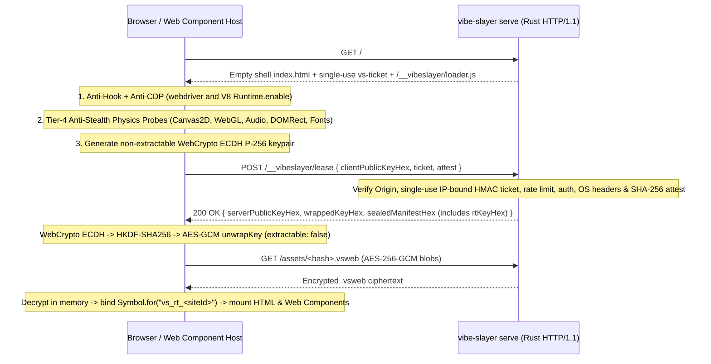

# Live Websites & Web Components Protection

[← Back to README](../README.md) · [CLI & Configuration](./cli-and-configuration.md) · [Threat Model](./threat-model-and-benchmarks.md)

Vibe-Slayer protects static sites, Single-Page Applications (React, Vue, Svelte, Vite, Lit), and **native Web Components** (`customElements.define`, Shadow DOM, ES Modules `.mjs`, classic `.js`) without shipping plaintext HTML, CSS, or JavaScript on disk or to scrapers — and **denies anti-detect / stealth browsers such as CloakBrowser** when `--anti-stealth` (or `antiStealth` in JS SDKs) is enabled.

---

## 1. Runtime Architecture (Zero Node.js)



### What Scrapers & Offline Rippers Receive
- `GET /` returns only a minimal bootstrap HTML shell (`0` bytes of your HTML, CSS, JS, or Custom Elements) plus a short-lived, single-use, IP-bound HMAC ticket (`vs-ticket`).
- `GET /__vibeslayer/vibeslayer.web.json` fails closed with `403 MANIFEST_SEALED_IN_LEASE`.
- All assets live on disk as `AES-256-GCM` `.vsweb` blobs (`iv(12) || ciphertext || tag(16)`) with AAD `VSWEB1|<rel_path>`.
- `vibeslayer.web.json` on disk contains **zero** `siteKey`, **zero** `masterKey`, and **zero** `rtKeyHex`.

---

## 2. Quickstart: Protecting a Web Components App

Suppose your app registers Shadow DOM Custom Elements across ES Modules (`.mjs`), classic scripts (`.js`), and inline `<script type="module">` tags:

```bash
# Recommended: Paranoid preset (enables --harden-js, --js-bloat-kb 96, --anti-cdp on, --anti-stealth strict)
./vibe-slayer website ./my-wc-app -o ./my-wc-app-protected \
  --preset paranoid \
  --origin https://app.example.com

./vibe-slayer serve ./my-wc-app-protected \
  --preset paranoid \
  --addr 127.0.0.1:8080 \
  --origin https://app.example.com
```

Or selectively enable Web Component CloakBrowser denial on top of `balanced`:

```bash
./vibe-slayer website ./my-wc-app -o ./my-wc-app-protected \
  --preset balanced \
  --harden-js \
  --anti-stealth strict

./vibe-slayer serve ./my-wc-app-protected \
  --preset balanced \
  --anti-stealth strict \
  --addr 127.0.0.1:8080 \
  --origin http://127.0.0.1:8080
```

---

## 3. Defense-in-Depth for Web Components

When protected with `--harden-js --anti-stealth balanced|strict` (or `--preset paranoid`), Web Components are guarded at **three independent layers**:

### Layer 1: Boot Loader Pre-Lease Denial (`vibe-slayer-loader.js`, served at `/__vibeslayer/loader.js`)
Before generating an ECDH keypair or calling `/__vibeslayer/lease`, the loader evaluates:
1. **`--anti-hook`**: verifies `crypto.subtle` and core prototypes have not been monkey-patched.
2. **`--anti-cdp`**: checks `navigator.webdriver` and triggers a V8 `Error.prepareStackTrace` `console.debug(new Error())` trap that fires when DevTools or a CDP AI agent calls `Runtime.enable`.
3. **`--anti-stealth`**: runs 6 hardware/physics invariant probes against anti-detect browsers (such as CloakBrowser):
   - **2D Canvas flat-fill noise** (`#808080` solid `fillRect` must produce 1 uniform RGB, `+2` if noisy)
   - **WebGL flat-clear noise** (`gl.clearColor(0.5, 0.5, 0.5, 1)` `readPixels` must produce 1 uniform RGB, `+2` if noisy)
   - **Silent `OfflineAudioContext` noise** (all-zero buffer must stay `0.0`, `+2` if non-zero samples appear)
   - **Integer-DPR `DOMRect` poisoning** (`left:10px; top:20px; width:100px; height:50px` must not drift sub-pixel, `+2` if poisoned)
   - **OS platform vs. mandatory system font lie** (`Win32`/`Windows` missing all of `Segoe UI`, `Tahoma`, `Consolas`, `Calibri`, or `MacIntel`/`macOS` missing all of `Helvetica Neue`, `Geneva`, `Menlo`, `+2` if 0/N)
   - **Spoofed D3D11 NVIDIA/RTX renderer** missing `KHR_parallel_shader_compile` with `< 30` extensions (`+1`)

If the score meets or exceeds the threshold (`balanced`: `>= 4`, `strict`: `>= 2`), the loader halts with **`Access denied: STEALTH_BROWSER_DENIED`** — **zero lease requests are sent and zero `.vsweb` components are decrypted**.

### Layer 2: Server-Side Attestation Gate (`vibe-slayer serve`)
In `--anti-stealth strict` (and `balanced` for explicit contradictions):
- The loader computes a ticket- and key-bound digest:
  `SHA-256("VS_ATTEST_V1|" + ticket + "|" + clientPublicKeyHex + "|" + score + "|" + flags + "|" + platform)`
- `serve` rejects:
  - Missing attestation (`strict`) → `403 STEALTH_ATTEST_REQUIRED`
  - Tampered/replayed digest → `403 STEALTH_ATTEST_INVALID`
  - Score `>= threshold` → `403 STEALTH_BROWSER_DENIED`
  - `HeadlessChrome` / `Playwright` / `Puppeteer` / `PhantomJS` UA (`strict`) → `403 AUTOMATION_DENIED`
  - OS header contradictions (e.g. `User-Agent: Linux` paired with `Sec-CH-UA-Platform: "Windows"` or `platform: "Win32"`) → `403 STEALTH_BROWSER_DENIED`

### Layer 3: Inline Self-Defense Guard Inside Every Hardened Web Component (`.js` / `.mjs`)
Even if a Tier-4 attacker bypasses the loader or manually extracts a single decrypted `.mjs`/`.js` Web Component file:
1. **Inline Synchronous Anti-Stealth Guard**: Every hardened `.js`/`.mjs` module begins (after any `"use strict";` directive prologue) with an inline synchronous Canvas2D + WebGL + DOMRect + OS/Font check. Inside CloakBrowser, the module throws **`Error("STEALTH_BROWSER_DENIED")`** *before* `customElements.define(...)` runs!
   - **SSR-Safe**: Guarded by `if (typeof document === "undefined") return;`, so server-side rendering in Node.js continues to work when the runtime key is supplied.
2. **Offline-Dead `rtKey` String Encryption**: String literals (`>= --min-str-len`) are XOR-masked with a per-site 32-byte `rtKey` that is **never written to disk** — it is delivered exclusively inside the ECDH-sealed lease manifest and bound to `globalThis[Symbol.for("vs_rt_<siteId>")]`. Running a dumped `.mjs` offline without a live lease throws `Error("VS_RUNTIME_KEY_REQUIRED")`.
3. **Polymorphic LLM Decoy State Machine (`--js-bloat-kb`)**: Appends a deterministic unreachable `switch`-based state machine (`96 KB` ≈ `48,000+` LLM tokens per file in `paranoid` mode) at ~0 ms runtime cost (V8 lazily skips compiling uncalled function bodies).

---

## 4. Programmatic Web Component Protection in JavaScript SDKs

Both JavaScript packages also expose the `antiStealth: "off" | "balanced" | "strict"` parameter for custom Web Component gateways and client loaders.

### A. `vibeslayer-suite` (`webProduct` & `src/client/web-client.js`)

```js
const { webProduct } = require("./vibeslayer-suite/src/index.js");

// Client / Web Component boot: denies CloakBrowser before ECDH session creation
const session = await webProduct.createBrowserEphemeralSession({
  antiStealth: "strict", // "off" | "balanced" | "strict"
  ticket: serverTicket,
});

// Server-side verification before issuing a Web Component lease
await webProduct.verifyStealthAttestation({
  mode: "strict",
  headers: req.headers,
  attest: req.body.attest,
  ticket: serverTicket,
  publicKey: req.body.clientPublicKeySpkiB64,
});

// Client unsealing (also re-checks antiStealth before decrypting VSPK bytes)
const componentBytes = await webProduct.unsealWebAssetWithSession({
  vspkBytes,
  grant,
  session,
  expectedOrigin: "https://app.example.com",
  antiStealth: "strict",
});
```

### B. `vibeslayer-policy-kit` (`definePolicy`, `createGateway`, `createClient`)

```js
const { definePolicy, createGateway, createClient } = require("./vibeslayer-policy-kit/src/index.js");

const policy = definePolicy({
  enabled: true,
  antiStealth: "strict", // default for all actions; can also be overridden per action
  signingSecret: process.env.VS_SIGNING_SECRET, // >= 32 bytes (Buffer or string)
  actions: {
    "wc.pricingCard.load": {
      mode: "client-sealed",
      antiStealth: "strict",
      allowedOrigins: ["https://app.example.com"],
      params: { plan: { type: "enum", values: ["starter", "pro", "enterprise"] } },
      handler: async ({ params }) => loadProtectedComponent(params.plan),
    },
  },
});

const gateway = createGateway(policy);
await gateway.listen(8090);

// Client blocks CloakBrowser locally and attaches the signed `attest` object in the JSON request body
const client = createClient({
  baseUrl: "http://127.0.0.1:8090",
  origin: "https://app.example.com",
  leaseToken,
  antiStealth: "strict",
});
const payload = await client.invokeSealed("wc.pricingCard.load", { plan: "enterprise" });
```

---

## 5. Live Verification: CloakBrowser 146 vs. Chrome 158

Empirically verified against a live multi-component Web Components app (`<vs-pricing-card>` Shadow DOM ES module `.mjs`, `<vs-secret-widget>` classic `.js`, and `<vs-inline-badge>` inline `<script type="module">`):

| Target | CloakBrowser 146 (`chromium-146.0.7680.177.5`) | Unmodified Google Chrome 158 |
| :--- | :--- | :--- |
| **`--preset paranoid` (`--anti-stealth strict`)** | **Denied (`STEALTH_BROWSER_DENIED`)** · `0` leases · `0/3` Custom Elements defined | **Allowed (`0` false positives)** · `3/3` Shadow DOM Custom Elements rendered |
| **`--preset balanced --harden-js --anti-stealth balanced`** | **Denied (`STEALTH_BROWSER_DENIED`)** · `0` leases · `0/3` Custom Elements defined | **Allowed (`0` false positives)** · `3/3` Shadow DOM Custom Elements rendered |
| **Extracted Standalone Hardened `pricing-card.mjs` (with `rtKey` pre-injected)** | **Denied (`CAUGHT_ERR:STEALTH_BROWSER_DENIED`)** · `customElements.get('vs-pricing-card') === undefined` | **Allowed (`IMPORTED_OK:true`)** · `<vs-pricing-card>` Shadow DOM rendered |

---

## 6. Choosing `--anti-stealth`: `balanced` vs. `strict`

| Mode | Threshold | Server Attestation | Headless UA Block | Best For |
| :--- | :---: | :---: | :---: | :--- |
| **`off`** | Disabled | Not required | Off | Local development, Playwright/Cypress CI pipelines |
| **`balanced`** | Score `>= 4` | Checked if supplied; OS-header lies blocked | Off | Public consumer websites where privacy-hardened browsers (e.g. Canvas-only farbling) should not trigger false positives |
| **`strict`** | Score `>= 2` | **Mandatory** SHA-256 `attest` bound to `ticket` + ECDH key | **Enabled** (`HeadlessChrome`, `Playwright`, `Puppeteer`) | High-value SaaS apps, paid Web Components, proprietary dashboards, and anti-CloakBrowser enforcement |

> **Privacy Browser Note**: Real Chrome, Firefox, Edge, and Safari score **`0/11`** (zero false positives in both `balanced` and `strict`). Privacy browsers that intentionally inject synthetic canvas noise (such as Brave Shields set to Aggressive or LibreWolf with RFP enabled) can score `+2`, which still passes **`balanced`** (requires `>= 4`, i.e. at least two independent hardware lies) while being flagged in **`strict`**. Use `balanced` if aggressive-farbling privacy browsers are part of your legitimate audience, and `strict` when CloakBrowser/automation denial is mandatory.

---

## 7. Per-Buyer Authenticated Access

Gate leases behind signed HMAC-SHA256 buyer tokens so every session is tied to an authenticated customer:

```bash
# 1. Generate a 32-byte (64-hex) HMAC key once
export VIBESLAYER_AUTH_HMAC_KEY=$(openssl rand -hex 32)

# 2. Start the runtime server with HMAC authentication
./vibe-slayer serve ./my-wc-app-protected \
  --preset paranoid \
  --addr 127.0.0.1:8080 \
  --origin https://app.example.com

# 3. Mint a time-limited token from your backend login flow
#    (--buyer allows 1..=128 ASCII alphanumeric or [-_@:] characters; avoid '.' dots)
./vibe-slayer mint-token --key "$VIBESLAYER_AUTH_HMAC_KEY" --buyer "alice@acme" --ttl 3600
```

Clients pass the minted token via `Authorization: Bearer <token>`, `X-VS-Auth: <token>`, or an `HttpOnly` cookie named `vs_auth=<token>`.
